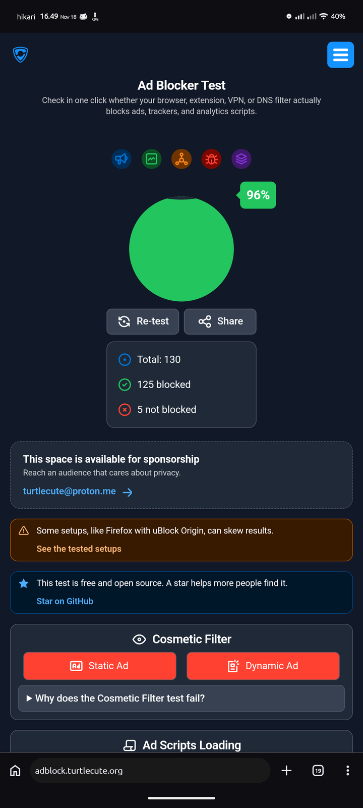
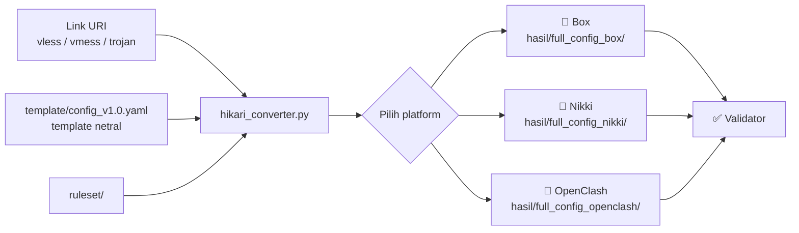

<div align="center">

# 🌸 HIKARI /.CLASH

**Toolkit CLI offline untuk convert & generate config Mihomo (Clash Meta)**
satu template → siap pakai di **Box for Root**, **Nikki**, dan **OpenClash**

<sub>Sebelumnya bernama *Hikari Subclash* / Hikari-SC.</sub>


</div>

---

## 📖 Daftar Isi

- [Kenapa Hikari?](#-kenapa-hikari)
- [Fitur](#-fitur)
- [Tampilan](#-tampilan)
- [Cara Kerja](#-cara-kerja)
- [Instalasi](#-instalasi)
- [Struktur Folder](#-struktur-folder)
- [Cara Pakai](#-cara-pakai)
- [Miscellaneous (Menu 5)](#-miscellaneous-menu-5)
- [Sniffer Only (Menu 5 → 5)](#-sniffer-only-menu-5--5)
- [Memasang Hasil ke Perangkat](#-memasang-hasil-ke-perangkat)
- [Perbedaan Output per Platform](#-perbedaan-output-per-platform)
- [Isi Template & Group](#-isi-template--group)
- [Ruleset](#-ruleset)
- [Tips & Trik](#-tips--trik)
- [Troubleshooting](#-troubleshooting)
- [FAQ](#-faq)
- [Roadmap](#-roadmap)
- [Disclaimer](#%EF%B8%8F-disclaimer)

---

## 💡 Kenapa Hikari?

Ngatur config Mihomo di tiga platform itu ribet: port beda, path beda, fitur Android (tun, per-app) bentrok dengan OpenWrt, dan hampir semua tool convert butuh internet. Hikari /.CLASH menyelesaikannya dengan:

- **Satu template netral**, bagian yang beda per platform disuntik otomatis.
- **Offline**: tempel link, jadi config. Tanpa subscription converter online.
- **Validator bawaan**: salah referensi group/rule/provider ketahuan *sebelum* config dipasang.

---

## ✨ Fitur

| | |
|---|---|
| 🔄 **Dua arah** | `vless://` `vmess://` `trojan://` ⇄ YAML Clash. Support WS, gRPC, HTTPUpgrade, H2, TLS, **Reality + flow/fingerprint**, ALPN, `allowInsecure`, IPv6 |
| 🎯 **Preview & edit** | Tabel preview, hapus/tambah node, baris gagal ditampilkan **lengkap dengan alasannya** |
| 🧬 **Anti duplikat** | Nama node kembar otomatis jadi `Nama (2)`, `Nama (3)` |
| 🦊 **Emoji otomatis** | Tiap node diawali emoji acak: `Singapore` → `🦊 Singapore`. Daftar emoji bisa diedit di menu |
| 🛠️ **Auto-patch platform** | Port, DNS listen, `tun`, path provider, controller, rule WIFI disesuaikan per platform |
| ✅ **Validator** | Cek group/rule/provider, file provider, port bentrok, controller tanpa secret, DNS rawan, dll |
| 🔌 **Mode Offline** | Ubah semua rule-provider `http` → `file` (tanpa update GitHub) |
| ♻️ **Regenerate** | Ubah template/DNS/profil ISP lalu bangun ulang config dari node yang sudah tersimpan — **tanpa paste URI lagi** (`1 → 3`) |
| ➕ **Replace / Append** | Timpa atau tambah node ke provider yang sudah ada |
| 🌐 **Menu DNS** | Preset (Cloudflare+Google, Quad9, NextDNS, AdGuard, [BebasDNS](https://github.com/bebasid/bebasdns)) dengan pilihan **DoH / DoT / DoQ**, atau **custom manual** (IP, DoH, DoH3, DoT, DoQ, UDP/TCP, `system`, `dhcp://`, akhiran `#proxy`) per field — divalidasi, ada preview diff, format & komentar template dijaga |
| 🧪 **Miscellaneous** | Converter rule-provider `.mrs` ⇄ `.yaml`/`.txt`, tester config (+ `mihomo -t`), tester node (offline / via core), tester route, **sniffer only** (config pengintai koneksi + inspector) — lihat [menu 5](#-miscellaneous-menu-5) |
| 🛡️ **Aman** | Auto-backup `.bak`, input divalidasi, `PermissionError` ditangani, pilihan secret dashboard (default `hikari` / acak) |

---

## 📸 Tampilan

Tangkapan layar dari perangkat penulis (Termux + Nikki di OpenWrt, jaringan XL Axiata). IP server node disensor.

<table>
<tr>
<td align="center" width="50%"><br><sub><b>Converter di Termux</b> — preview node, pilih platform/provider, profil ISP XL, hasil validasi</sub></td>
<td align="center" width="50%"><br><sub><b>Rantai routing</b> — <code>SMART ROUTING → Inject → PROXY LIST → node</code> terlihat di dashboard Mihomo</sub></td>
</tr>
<tr>
<td align="center"><br><sub><b>Group dari template</b> — Inject, AUTO MODE, PROXY LIST, SMART ROUTING, BLOCKER, PLUSPLUS, GAMING</sub></td>
<td align="center"><br><sub><b>Ad Blocker Test</b> — 125 dari 130 diblokir (96%) dengan ruleset Blocker aktif</sub></td>
</tr>
</table>

<div align="center">
<br>
<sub><b>dnscheck.tools</b> setelah DNS memakai DoH berbasis IP (v0.7+): validasi DNSSEC lulus untuk ECDSA P-256/P-384 dan Ed25519; MLDSA44 bertanda * karena algoritmanya belum luas divalidasi (menurut halaman tesnya sendiri)</sub>
</div>

> Ini hasil di satu perangkat dan satu jaringan, bukan jaminan untuk setiap setup.

---

## 🧠 Cara Kerja



Pipeline: `template → parse YAML → patch per platform → validasi → tulis config.yaml`.

---

## 📦 Instalasi

**Termux (Android):**

```bash
pkg update && pkg install python git -y
pip install pyyaml
termux-setup-storage          # izinkan akses penyimpanan
```

**Linux / OpenWrt / PC:**

```bash
pip install pyyaml            # butuh Python 3.8+
```

**Opsional — konversi `.mrs`** (menu 5 → 1) butuh kompresi zstd. Python 3.14+ sudah bawaan; selain itu pasang salah satu: `pkg install zstd` (Termux), `pip install zstandard`, atau `opkg install libzstd zstd` (OpenWrt). Cek statusnya di menu `5 → 5`.

**Ambil project:**

```bash
git clone https://github.com/nexterade/hikari-clash.git hikari-clash
cd hikari-clash
```

> Di Termux, taruh foldernya di `/storage/emulated/0/Documents/hikari-clash` — **jangan** di `~` biar tidak kena `PermissionError` dan gampang diakses file manager.

---

## 📂 Struktur Folder

```text
hikari-clash/
├── hikari_converter.py          # Script utama (menu & generator)
├── banner.py                    # Banner Hikari /.CLASH
├── mrs_codec.py                 # Codec rule-set .mrs ⇄ .yaml/.txt   (menu 5)
├── sub2yaml.py                  # Subscription (base64) ➜ YAML Clash, dites & diurut; hasilnya diimpor ke 🛹 Free node (menu 1 → 4)
├── src/                         # Sumber subscription untuk sub2yaml: barry-far.txt, 0xRadikal.txt (update lewat menu [8] sub2yaml)
├── bin/                         # (otomatis, tidak di-commit) core mihomo hasil unduh sub2yaml; di /sdcard dipasang di ~/.hikari-clash/bin
├── nodetest.py                  # Tester node proxy                  (menu 5)
├── routetest.py                 # Tester route domain/IP             (menu 5)
├── sniffer.py                   # Inspector koneksi (Sniffer Only)   (menu 5)
├── template/
│   ├── sniffer_only.yaml        # Config pengintai: tanpa node, semua DIRECT (bukan template konversi; tidak ikut glob config_v*.yaml)
│   ├── config_v1.0.yaml         # Template master terbaru (netral, + group 🥪 Subscription & 🛹 Free node, provider node gratis)
│   ├── config_v0.9.yaml         # Template master lama (dibiarkan utuh)
│   ├── config_v0.8.yaml         # Template master lama (dibiarkan utuh)
│   ├── config_v0.7.yaml         # Template master lama (dibiarkan utuh)
│   ├── config_v0.6.yaml         # Template master lama (dibiarkan utuh)
│   ├── config_v0.5.yaml         # Template master lama (dibiarkan utuh)
│   ├── config_v0.4.yaml         # Template master lama (dibiarkan utuh)
│   ├── config_v0.3.yaml         # Template master lama (dibiarkan utuh)
│   └── template.yaml            # (otomatis) salinan kerja, dibuat saat kamu edit lewat menu
├── subscription.yaml            # Node gratis (100 node, dibuat sub2yaml.py) — URL raw-nya dipakai provider 🍞 Subscription
├── emoji.json                   # Daftar emoji nama node (edit lewat menu atau langsung di file)
├── settings.json                # (otomatis, tidak di-commit) pengaturan pengguna: profil ISP
├── ruleset/                     # Ruleset (WAJIB): *.yaml & *.mrs
├── archive/                     # Template lama v0.1/v0.2 + port-games versi penuh
├── tests/                       # Tes otomatis: python3 -m unittest discover -s tests
├── docs/img/                    # Screenshot untuk README
├── AUDIT.md                     # Perbandingan template, temuan audit, saran
└── hasil/                       # (otomatis) hasil generate
    ├── full_config_box/
    ├── full_config_nikki/
    ├── full_config_openclash/
    └── rules/                   # hasil Rule-Provider Converter (menu 5)
```

Template yang dipakai: **`template/template.yaml`** bila ada, kalau tidak **`template/config_v*.yaml` terbaru**. Edit lewat menu selalu mengubah `template/template.yaml`; template master tidak pernah disentuh. Template baru ditambahkan sebagai file baru (`config_v0.5.yaml`, dst.), versi lama tidak ditimpa.

> Upgrade dari layout lama? Saat dijalankan, script otomatis memindahkan `Hasil/` → `hasil/` dan `template.yaml` (root) → `template/template.yaml`.

---

## 🚀 Cara Pakai

```bash
cd /storage/emulated/0/Documents/hikari-clash
python hikari_converter.py
```

### Menu utama

```text
[1] Convert                 ← link ⇄ Clash YAML, regenerate dari node tersimpan, impor free node (sub2yaml)
[2] Edit Configuration      ← port & secret, ganti template, DNS, emoji node
[3] Check Status            ← template, provider, config yang sudah jadi
[4] Validasi / Audit Config ← cek template untuk ketiga platform
[5] Miscellaneous           ← converter .mrs, tester config / node / route, sniffer only
────────────────────────────
[Q] Exit
```

### Alur Convert (URI ➜ Clash)

1. **Paste** link (`vless://` / `vmess://` / `trojan://`), satu per baris. Enter 2× untuk selesai.
2. **Preview**: lihat daftar node. Aksi: `[T]` tambah · `[H]` hapus (mis. `1,3`) · `[L]` lanjut · `[B]` batal.
   Baris yang gagal ditampilkan beserta alasannya (UUID kosong, transport belum didukung, dll).
3. **Pilih platform**: `B` Box · `N` Nikki · `O` OpenClash.
4. **Pilih provider**: `active.yaml` atau `trial.yaml`. Jika sudah berisi node, pilih **Ganti** atau **Tambahkan**.
5. **Mode rule-provider**: ikuti template (auto-update GitHub) atau **Offline** (file lokal saja).
6. **Secret dashboard**: `[1]` ikuti template (default: `hikari`) atau `[2]` acak.
7. Selesai. Script menampilkan lokasi hasil, hasil validasi, dan secret yang dipakai.

### Regenerate dari node tersimpan

Menu `1 → 3`. Kamu mengubah template, DNS, profil ISP, emoji, atau secret dan ingin config baru **tanpa paste URI lagi**? Script membaca node dari `hasil/full_config_*/proxy*/active.yaml` dan `trial.yaml`, lalu membangun ulang `config.yaml` + ruleset dari template yang sedang aktif.

- **`[1]…[n]`** — pilih satu sumber (mis. `nikki/active.yaml`, lengkap dengan jumlah node & waktu ubah). Enter = tetap di platform/provider yang sama, jadi file node-nya **tidak** ditanya timpa/tambah. Pilih platform lain untuk menyalin node ke sana (format node sama di semua platform).
- **`[A]`** — bangun ulang semua sumber sekaligus dengan pilihan baku: rule-provider & secret ikut template, profil ISP dari `settings.json`.
- Nama node dipakai apa adanya (emoji tidak ditambah lagi), dan node di provider lain tidak disentuh.

### Free node dari sub2yaml (🛹 Free node)

Menu `1 → 4`. Mengisi `proxy/free.yaml` — provider `📖 Free node` yang dipakai group **🛹 Free node** — dari keluaran `sub2yaml`.

1. **Sumber**: pilih `[1]` untuk menjalankan `sub2yaml.py` langsung (menu & tampilannya sama dengan Hikari), atau `[2]` untuk memilih/mengetik path file YAML hasilnya (mis. `hasil/proxy/free.yaml`). `subscription.yaml` repo juga bisa dipilih sebagai contoh.
2. **Platform**: `B` Box · `N` Nikki · `O` OpenClash · `A` semua (default). Nama folder mengikuti platform: `proxy/` untuk Box & Nikki, `proxy_provider/` untuk OpenClash.
3. **Mode**: **Ganti** isi `free.yaml` (yang lama dibackup `.bak`) atau **Tambahkan**.
4. Node divalidasi: wajib punya `name`, `type`, `server`, `port` (yang tidak lengkap dibuang dan dilaporkan); nama yang bentrok dengan group template atau node di `active.yaml`/`trial.yaml` otomatis jadi `Nama (2)`. Emoji acak **tidak** ditambahkan (nama dari sub2yaml dipakai apa adanya).
5. `config.yaml` tidak perlu di-generate ulang. Restart core (atau update provider dari dashboard) supaya node baru terbaca. Generate/Regenerate berikutnya tidak menimpa `free.yaml`.

#### sub2yaml.py

Bisa juga dijalankan sendiri: `python3 sub2yaml.py` (menu interaktif) atau lewat argumen (lihat `--help`).

```text
[1] Pilih source (file)                  ← pilih file di src/ (boleh gabungan)
[2] URL custom (base64)
[3] Tambah URL (gabungkan beberapa sumber)
[4] Ubah jumlah node free.yaml (0 = semua yang berhasil)
[5] Ubah folder output
[6] Ganti urutan (negara / ping)
[7] Edit config (SNI / Host / Address / dll)
[8] Update source                        ← unduh ulang src/*.txt dari URL aslinya
[Enter] Mulai    [0] Keluar
```

- **Source**: pertama kali jalan, node diambil dari file `.txt` di `src/` (`barry-far.txt`, `0xRadikal.txt`; kalau `src/` kosong akan diunduh otomatis). Perbarui kapan saja lewat menu `[8]` atau `python3 sub2yaml.py --update-source`. File lama baru diganti kalau unduhan valid. File `.txt` lain yang kamu taruh di `src/` ikut muncul di menu `[1]`.
- **Output**: `hasil/proxy/` (`free.yaml`, `custom-*.yaml` bila Edit config diisi, `report.txt`). Path relatif selalu relatif ke folder script, bukan folder tempat kamu menjalankan.
- **Format YAML**: block style persis seperti `active.yaml` (tanpa `{}`/`[]` inline); nilai berisiko (angka-like, `true`/`null`, karakter khusus) otomatis diberi tanda kutip, dan keluaran dicek round-trip lewat PyYAML.
- **Validasi offline**: node yang pasti ditolak mihomo dibuang sebelum dites dan dicatat di `report.txt` (UUID bukan format UUID, reality `public-key`/`short-id` rusak, reality di network selain tcp/grpc/h2, `flow` di luar tcp, SNI/server mengandung spasi atau karakter terlarang). Ini berlaku juga di mode TCP-only.
- **Tes (URL-test mihomo wajib)**: tiap node dites lewat core Mihomo sungguhan (connect lewat node ke `gstatic generate_204`, lalu dikonfirmasi sekali lagi ke `cp.cloudflare.com`). Hanya node yang punya ping di kedua tes dan rata-rata ≤ `--max-ping` (default 3000 ms) yang masuk file. Core dicari otomatis (`./bin`, `~/.hikari-clash/bin`, `PATH`, `HIKARI_MIHOMO`, lokasi OpenClash) dan **diunduh otomatis** dari GitHub (MetaCubeX/mihomo) bila belum ada: varian sesuai perangkat (mis. `android-arm64`, lalu `linux-arm64`), unduhan bisa **dilanjutkan** kalau terputus (`bin/*.part`), dan dipakai hanya setelah terbukti bisa dijalankan (`mihomo -v`). Menu `[9]` = unduh/perbarui manual, `--no-download` mematikan unduh otomatis, `--mihomo /path` memakai core sendiri (core Box di `/data/adb` butuh root, jadi tidak dipakai otomatis). **Android/Termux:** kalau folder Hikari ada di penyimpanan bersama (mis. `/storage/emulated/0/Project/hikari-clash`), file di sana tidak boleh dieksekusi, jadi core otomatis dipasang di `~/.hikari-clash/bin/` (home Termux). Jumlah node bebas: `--top N` atau menu `[4]` — tes dikerjakan per batch dan berhenti begitu N node lolos. Tes TCP **bukan lagi cadangan otomatis** (hanya mengecek port terbuka, bukan berarti bisa dipakai); `--tcp-only` tetap ada tapi harus dipilih sengaja. Kalau hampir semua ping TCP ≤3 ms (koneksi dicegat Box/Nikki/VPN lokal), tahap TCP dilewati otomatis dan semua node langsung di-URL-test — sebaiknya matikan Box/VPN saat menjalankan sub2yaml.

### Convert Clash ➜ URI

Menu `1 → 2`: paste YAML, atau pilih file provider hasil generate. Hasil bisa disimpan ke `hasil/URI_<tanggal>.txt`.

### Edit Configuration

- **Port & Secret**: ketik `acak` pada Secret untuk generate otomatis. Port divalidasi 1–65535.
- **Ganti Template**: pilih dari `template/config_v*.yaml` yang ada, atau path file sendiri (divalidasi sebelum dipakai).
- **DNS & Nameserver** (`2 → 3`): lihat isi tiap field beserta jenisnya (`[DoH]`, `[DoT]`, `[UDP]`, …), lalu:
  - **Preset** — urutan: **BebasDNS (default)**, Cloudflare+Google, Quad9, NextDNS, AdGuard. Pilih provider + protokol (DoH/DoT/DoQ; DoQ hanya di provider yang menyediakannya). **BebasDNS** punya 4 varian: Bawaan, Security (anti-malware), Unfiltered, Family — hanya DoH/DoT, dan karena BebasDNS tidak punya IP polos publik, field IP-nya diisi 1.1.1.1 & 8.8.8.8. Memilih BebasDNS otomatis mengisi `nameserver` = BebasDNS dan `fallback` = Cloudflare + Google. `nameserver`/`fallback` diisi alamat terenkripsi, sedangkan `default-`/`proxy-server-`/`direct-nameserver` diisi IP polos dari provider yang sama.
  - **Custom manual** — pilih field target (boleh beberapa, mis. `1,3`), lalu ketik entri bebas format, satu per baris atau pisah koma. Contoh: `1.1.1.1`, `8.8.8.8:53`, `https://dns.google/dns-query`, `tls://1.1.1.1`, `quic://dns.adguard-dns.com`, `tcp://1.1.1.1`, `system`, `dhcp://wlan0`, `https://1.1.1.1/dns-query#NamaGroup`. Mode **Ganti** atau **Tambahkan**.
  - **Kembalikan ke master** — salin nilai DNS dari template master terbaru.
  - **Profil ISP** — lihat [DNS leak & provider XL Axiata](#-tips--trik).
  - **Mode Anti-Blokir** (`2 → 3 → 5`) — mengubah `nameserver`, `fallback`, `proxy-server-nameserver`, `direct-nameserver` jadi DoH berbasis IP (Cloudflare/Google), sehingga tidak ada query DNS polos port 53 yang bisa dibelokkan ISP. Pilihan `[2]` membiarkan `proxy-server-nameserver` apa adanya (kalau node timeout). Idempoten: kalau sudah sama, tidak mengubah apa-apa.
  - Aturan per field: `default-nameserver` **harus IP** (ditolak kalau bukan); `nameserver`/`fallback` diperingatkan kalau tidak terenkripsi; `proxy-server-nameserver` diperingatkan kalau terenkripsi semua. Selalu ada preview `-`/`+` dan konfirmasi sebelum menulis, plus backup `.bak`.
- **Emoji Node**: lihat daftar emoji, `[A]` tambah, `[H]` hapus (nomor), `[T]` nyalakan/matikan, `[R]` reset ke bawaan. Tersimpan di `emoji.json`.

---

## 🧪 Miscellaneous (Menu 5)

Kumpulan tools tambahan. Semuanya offline; yang butuh sesuatu dari luar (core Mihomo, zstd) bilang jelas kalau belum ada.

| Submenu | Fungsi | Catatan |
|---|---|---|
| **1. Rule-Provider Converter** | `.mrs` ⇄ `.yaml` / `.txt`. Arah otomatis dari ekstensi; ada mode batch (semua `.mrs` di `ruleset/` → YAML) dan info `.mrs` | Hasil di `hasil/rules/`. Perlu backend zstd (lihat [Instalasi](#-instalasi)). `domain` sudah diuji: hasil tulis identik (setelah dekompresi) dengan `blocker.mrs` & `plus18.mrs`; `ipcidr` belum diuji dengan file asli → cek dengan core sebelum dipakai |
| **2. Config Tester** | Validator internal untuk config hasil generate + `mihomo -t` kalau core ketemu (PATH, lokasi umum Box/OpenClash, atau env `HIKARI_MIHOMO`) | Juga menjalankan **audit DNS leak statis** (DNS ISP / tak terenkripsi di nameserver & fallback, respect-rules, fake-ip, IPv6). Tes core untuk Nikki dilewati di luar perangkat Nikki (path-nya absolut `/etc/nikki/run`) |
| **3. Proxy Node Tester** | **Offline**: DNS → TCP → TLS ke server node. **Via core**: delay sungguhan lewat `external-controller` | Offline hanya menjawab "server terjangkau dari jaringan ini?", bukan "proxy tembus ke internet?". Node UDP (hysteria/tuic) dilewati. Node hidup bisa disimpan ke `hasil/nodes_ok_*.yaml` |
| **4. Route Tester** | Ketik domain/IP (`chatgpt.com`, `1.1.1.1:443`, `udp://x.com:443`) → rule & group yang kena | Tanpa DNS lookup; rule `GEOIP`/`SRC-*`/`PROCESS-*` ditandai "tidak bisa dievaluasi", tidak ditebak |
| **5. Sniffer Only** | Config pengintai tanpa node + inspector detail per koneksi — lihat [Sniffer Only](#-sniffer-only-menu-5--5) | Semua trafik DIRECT lewat kuota reguler |
| **6. Info Lingkungan** | Versi Python/PyYAML, backend zstd, lokasi core, template aktif | Berguna untuk debugging |

---

## 🔎 Sniffer Only (Menu 5 → 5)

Config khusus **mengintip koneksi**, bukan menerowongnya: **tanpa node, tanpa provider, semua trafik DIRECT lewat kuota reguler** (tidak ada bug-host, SNI custom, atau DNS khusus ISP). Dipakai untuk melihat ke mana saja sebuah aplikasi/situs benar-benar terhubung.

| Submenu | Fungsi |
|---|---|
| **1. Generate Config** | Bangun `hasil/sniffer/<platform>/config.yaml` dari `template/sniffer_only.yaml` untuk Box / Nikki / OpenClash (opsional: ASN, secret acak). Hanya `config.yaml` yang perlu disalin ke perangkat; folder provider tidak ada |
| **2. Inspector Live** | Membaca `/connections` dari core yang sedang jalan, mencetak koneksi baru (mode ringkas atau detail), lalu ringkasan sesi dan ekspor CSV/JSON ke `hasil/sniffer/` |
| **3. Update CIDR CDN** | Unduh daftar resmi Cloudflare (`cloudflare.com/ips-v4`, `ips-v6`) dan CloudFront (AWS `ip-ranges.json`, layanan `CLOUDFRONT`) ke cache lokal. Memakai kuota reguler, ukuran `ip-ranges.json` beberapa MB |

**Data per koneksi:** alamat tujuan (IP:port), host hasil **sniff** (SNI/Host) dan host dari **DNS** (dipisah), subdomain, domain dasar, GeoIP negara, ASN (bila diaktifkan), CDN (Cloudflare / CloudFront) beserta **dasar deteksinya** (`rule` / `ip` / `host`), rule + chain, sumber, aplikasi (Box: nama package), dan trafik ↑/↓.

**Cara kerja config:**

| Setelan | Alasan |
|---|---|
| `sniffer.override-destination: false` | IP tujuan asli dan host hasil sniff tetap terpisah (`destinationIP` vs `sniffHost`) |
| `dns.enhanced-mode: redir-host` | `destinationIP` berisi IP sungguhan, bukan `198.18.x.x` (fake-ip) |
| `geodata-mode: false` + rule probe `GEOIP,ZZ,DIRECT` | Mihomo mengisi `destinationGeoIP` hanya di mode mmdb; negara `ZZ` tidak pernah cocok, jadi rule ini hanya mengisi cache GeoIP |
| Group `🔶 Cloudflare`, `🟧 CloudFront`, `🏠 LAN`, `🧭 DNS`, `🔍 Lainnya` (isinya cuma `DIRECT`) | Label: dashboard (MetaCubeXD, Zashboard, Yacd) langsung menampilkan kolom chain tanpa inspector |

**Batasan yang perlu diketahui:**
- Cloudflare dikenali dari daftar CIDR inline di template; CloudFront di config hanya dari nama `*.cloudfront.net`. Pengenalan CloudFront lewat **IP** dilakukan inspector setelah submenu 3 dijalankan. Tebakan dari nama host (`workers.dev`, `pages.dev`, …) ditandai `dasar: host`, itu bukan bukti.
- Sniffer hanya melihat SNI / Host header / QUIC SNI. Koneksi tanpa itu (ECH, protokol non-HTTP) tampil sebagai **IP murni**.
- Subdomain dipecah dengan heuristik (daftar akhiran multi-label kecil seperti `co.id`), bukan Public Suffix List penuh.
- GeoIP butuh mode mmdb dan file `country.mmdb`/`geoip.metadb` di core. ASN butuh `GeoLite2-ASN.mmdb`, diunduh core saat start kalau opsi ASN dipilih.
- Nikki/OpenClash menimpa port, DNS, dan controller dari LuCI; pastikan di sana tidak memakai mode `geoip.dat` kalau ingin kolom GeoIP terisi.
- Config **belum diuji dengan core Mihomo asli**; yang teruji: validator internal, struktur config, dan inspector terhadap controller tiruan. Config Tester (menu `5 → 2`) hanya memeriksa config utama, bukan config sniffer; uji dengan `mihomo -t -d <folder core> -f hasil/sniffer/<platform>/config.yaml` sebelum dipakai.

---

## 📲 Memasang Hasil ke Perangkat

Semua hasil ada di folder `hasil/`.

### 📱 Box for Root → `hasil/full_config_box/`

Salin **semua isi folder** ke:

```text
/data/adb/box/clash/
```

### 🐧 Nikki → `hasil/full_config_nikki/`

| Salin | Ke |
|---|---|
| `config.yaml` | `/etc/nikki/profiles/` |
| folder `proxy/` dan `ruleset/` | `/etc/nikki/run/` |

*Jangan dibalik — Nikki memisahkan profile dan file yang berjalan.*

### 🐧 OpenClash → `hasil/full_config_openclash/`

| Salin | Ke |
|---|---|
| `config.yaml` | `/etc/openclash/config/` |
| folder `proxy_provider/` dan `rule_provider/` | `/etc/openclash/` |

Pindahkan file ke OpenWrt pakai SFTP/WinSCP/scp, atau file manager yang punya akses root.

> ⚠️ **Nikki & OpenClash** umumnya menimpa port, DNS, TUN, controller, dan secret dari pengaturan LuCI-nya sendiri. Kalau dashboard minta secret, pakai yang diset di LuCI.

---

## 🔀 Perbedaan Output per Platform

| | 📱 Box | 🐧 Nikki | 🐧 OpenClash |
|---|---|---|---|
| Port | 7890 / 7891 / 7892 / **9797** / **9898** | dari template | dari template |
| DNS listen | **1053** | dari template | dari template |
| Blok `tun` | ada (off, dikelola Box) | dibuang | dibuang |
| `find-process-mode`, `geodata-mode`, `experimental`, `external-ui` | disuntik (`always`, `./dashboard`) | – | – |
| Group & rule **WIFI** | ada | **dibuang** | **dibuang** |
| Path provider | `./proxy`, `./ruleset` | `/etc/nikki/run/proxy`, `/etc/nikki/run/ruleset` | `./proxy_provider`, `./rule_provider` |
| `external-controller` | `127.0.0.1:9090` | `0.0.0.0:9090` | `0.0.0.0:9090` |

**Kenapa WIFI dibuang di OpenWrt?** Rule itu mencocokkan IP sumber `192.168.0.0/16`. Di router, *semua* client LAN punya IP itu, jadi seluruh trafik akan jatuh ke group WIFI (default Direct) dan proxy tidak pernah jalan.

---

## 🧩 Isi Template & Group

Urutan rule = prioritas (atas ke bawah):

| # | Rule-set | Group tujuan | Fungsi |
|---|---|---|---|
| 1 | `Direct` | DIRECT | LAN, `.local`, `.lan` |
| 2 | `DnsHijack` | 🐬 Hijack | DNS port 53 |
| 3 | `Reject` | ✂️ Reject | DoT (853) & QUIC (UDP 443) |
| 4 | `WifiClients` | 🍪 Wifi | Client WiFi/hotspot *(Box saja)* |
| 5 | `Blocker` | 💤 AdBlock | Blokir iklan |
| 6 | `Plusplus` | 💕 Plusplus | Unblock konten +18 |
| 6b | *(inline)* `AND,((NETWORK,UDP),(DST-PORT,3478-3479))` dan `…19302-19309` | 🧩 Inject | STUN/TURN (WebRTC) dipaksa lewat proxy supaya IP asli tidak bocor *(v0.6)* |
| 7 | `Portgames` | 🪼 Gaming | Port game (default Direct) |
| 8 | `Inject` | 🧩 Inject | Google, Bing, DuckDuckGo |
| 9 | `SmartMode` | 🌳 SMART ROUTING | AI, game launcher, sosmed, ISP |
| – | `MATCH` | 🧩 Inject | Sisanya |

Group node: **🧩 Inject** (pusat), **🛸 AUTO MODE** (url-test), **👒 PROXY LIST** (pilih manual). Ketiganya memakai provider **🗳️ Active** + **📅 Trial** (node milikmu). Sejak v1.0 ada dua group tambahan, juga bisa dipilih dari 🧩 Inject:

| Group | Provider | Isi |
|---|---|---|
| **🥪 Subscription** | `🍞 Subscription` (`http`, `proxy/subs.yaml`) | Node gratis dari `subscription.yaml` repo, di-update otomatis lewat group 🛸 AUTO MODE |
| **🛹 Free node** | `📖 Free node` (`file`, `proxy/free.yaml`) | Khusus keluaran **sub2yaml**: diisi lewat `1 → 4` (file kosong `proxies: []` dibuat otomatis saat generate, tidak pernah ditimpa) |

Nama group di tabel ini identik dengan `template/config_v1.0.yaml` — kalau kamu mengganti nama di template, ganti juga di `rules:` dan `proxies:` group yang mengacu ke nama itu.

---

## 📚 Ruleset

| File | Isi |
|---|---|
| `blocker.mrs` | Daftar iklan (domain, format mrs) |
| `plus18.mrs` | Daftar +18 (domain, format mrs) |
| `smartmode.yaml` | Domain/CIDR untuk SMART ROUTING |
| `inject.yaml` | Domain yang selalu lewat Inject |
| `direct.yaml` / `reject.yaml` / `dns-hijack.yaml` | Aturan dasar |
| `wifi.yaml` | Client WiFi (SRC-IP) |
| `port-games.yaml` | 87 range port game (versi penuh ada di `archive/`) |
| `fakeip-filter.yaml` | Domain yang di-resolve IP asli |
| `skip-sniff.yaml` / `force-sniff.yaml` | Daftar sniffer |

Rule-provider di template bertipe `http` (update tiap 24 jam dari GitHub); file di `ruleset/` dipakai sebagai cache awal. Mau 100% offline? Pilih **Mode Offline** saat generate.

---

## 🎒 Tips & Trik

**🔖 Alias Termux** — cukup ketik `hikari`:

```bash
echo 'alias hikari="cd /storage/emulated/0/Documents/hikari-clash && python hikari_converter.py"' >> ~/.bashrc
source ~/.bashrc
```

**📦 Active vs Trial** — `active.yaml` untuk node harian, `trial.yaml` untuk node yang lagi dicoba. Keduanya otomatis masuk **AUTO MODE** dan **PROXY LIST**.

**🥪 Subscription & 🛹 Free node (v1.0)** — saat generate, script menaruh `proxy/subs.yaml` (salinan `subscription.yaml` sebagai cache awal) dan `proxy/free.yaml` (kosong, untuk hasil sub2yaml) di samping `active.yaml`/`trial.yaml`. Di Mode Offline, provider `🍞 Subscription` ikut jadi `file` (tidak auto-update). Regenerate (`1 → 3`) hanya membaca `active.yaml`/`trial.yaml`; `subs.yaml` dan `free.yaml` tidak dianggap sumber node. Isi `free.yaml` dari sub2yaml lewat `1 → 4`. ⚠️ Node gratis publik dikelola pihak lain: jangan dipakai untuk login/transaksi sensitif, karena operator node bisa melihat trafik yang tidak terenkripsi end-to-end.

**🦊 Emoji nama node** — tiap link yang di-convert dapat emoji acak (tidak berulang dalam satu batch selama daftarnya cukup). Edit lewat `2 → 4`, atau ubah langsung `emoji.json`. Nama yang sudah berawalan emoji (apa pun, mis. `🪟 Rekayasa` atau `🇸🇬 Singapore`) dibiarkan apa adanya, tidak jadi dobel, jadi aman dipakai bareng Append. Tambah emoji dengan spasi/koma sebagai pemisah, mis. `🦊 🐼 🐯`.

**➕ Pakai Append** — tambah node baru tanpa menghapus yang lama. Nama otomatis dijaga unik.

**🌐 Tips DNS (penting!)**

- **Default sekarang (v0.9 dan v1.0):** `nameserver` = **BebasDNS Unfiltered** (DoH), `fallback` = **Cloudflare + Google** (DoH), `proxy-server-nameserver` & `default-nameserver` = `1.1.1.1`/`8.8.8.8`, `direct-nameserver` = Quad9 `9.9.9.10`/`149.112.112.10`, `fallback-filter.geoip: false`. Dengan `respect-rules` + `fake-ip`, query DNS domain yang lewat proxy keluar lewat proxy, jadi dnsleak test seharusnya menampilkan resolver BebasDNS/Cloudflare/Google, bukan DNS ISP. DNS polos di `proxy-server-`/`direct-nameserver` bisa dibelokkan ISP (hipotesis, belum diuji di jaringan XL); kalau terjadi, pakai **Mode Anti-Blokir** (template v0.7/v0.8 sudah begitu). Menu `5 → 2` memeriksa ini secara statis; verifikasi akhir tetap lewat dnsleaktest.com / bash.ws dari perangkat. (Catatan: Mihomo meng-query `fallback` bersamaan dengan `nameserver`, jadi **semua** isi keduanya harus non-ISP.)
- `fallback-filter.geoip: false` dipasang karena filter bawaan Mihomo (geoip CN) tidak relevan di Indonesia. Perilaku persisnya belum diuji di core asli; validator memperingatkan kalau `fallback` dipakai tanpa itu.
- **Hasil dnscheck.tools:** tabel **DNSSEC** akan tetap FAIL semua — itu normal. Mihomo tidak memvalidasi DNSSEC, `fake-ip` selalu menjawab, dan resolve asli terjadi di resolver server node. Yang menentukan lolos/tidaknya kebocoran adalah daftar "Your DNS resolvers" (tidak boleh ada resolver ISP-mu) dan "Your IP addresses" (tidak boleh ada IP ISP-mu; kalau ada, cek koneksi DIRECT di dashboard).
- **Internet Positif / situs terblokir:** tiga lapis berbeda. (1) DNS ISP dibelokkan → diatasi fake-ip untuk domain yang lewat proxy, dan DoH berbasis IP (v0.7 / Mode Anti-Blokir) untuk sisanya. (2) Koneksi lewat proxy tapi `ERR_CONNECTION_CLOSED` dengan `DL 0 B` di dashboard dan *Remote address* berupa IP Indonesia → server node-nya sendiri yang menutup koneksi (DNS/egress server di dalam jaringan yang menyensor); tidak bisa diperbaiki dari config klien — coba node di luar negeri dan bandingkan. (3) Rule: pastikan domain-nya jatuh ke 🧩 Inject, bukan DIRECT (kolom Rule/Chains di dashboard). Tes terbaik: buka situs terblokir lalu lihat Chains-nya, bukan dnscheck.tools (DNSSEC tidak ada hubungannya dengan sensor).
- **XL Axiata:** di jaringan XL, tunneling Nikki/OpenClash butuh DNS `112.215.203.254`. Pilih **Profil ISP → XL Axiata** (menu `2 → 3 → 4`, atau saat generate untuk Nikki/OpenClash). Script menyuntikkannya ke `default-nameserver` dan `proxy-server-nameserver` — hanya me-resolve host DoH & domain server proxy, **bukan** domain yang kamu buka, sehingga dnsleak tetap bersih. Template v0.2 dulu menaruhnya juga di `fallback`; kalau tunneling masih gagal, tambahkan `fallback` lewat menu yang sama — tapi DNS XL lalu akan terlihat di dnsleak (audit menandainya `LEAK`). Pengaturan tersimpan di `settings.json`; Box tidak diubah.
- `nameserver` (DoH) lewat proxy → aman dari reset ISP.
- `proxy-server-nameserver` & `direct-nameserver` sengaja **DNS polos** (`8.8.8.8`, `1.1.1.1`). Banyak ISP/modem **me-reset DoH** ke IP publik port 443; kalau itu dipakai untuk resolve domain server proxy, **semua node timeout**.
- Kalau `8.8.8.8` ikut diblok di jaringanmu, ganti ke DNS ISP lewat menu *DNS → Custom manual* (field `proxy-server-nameserver`) atau edit `template/template.yaml`.
- Preset hanya mengisi `proxy-server-nameserver` dengan IP polos; kalau kamu isi dengan DoH/DoT lewat Custom, menu dan validator akan memperingatkan.
- **BebasDNS** (`dns.bebasid.com`, MIT): kalau ISP/WiFi-mu memakai DPI dan memblokir domain DoH/DoT-nya, hubungi `dukungan@bebasid.com` untuk domain alternatif, lalu masukkan lewat *Custom manual*.
- Host DoH/DoT/DoQ berupa domain (mis. `dns.google`) di-resolve lewat `default-nameserver`, makanya field itu wajib IP.

**🔌 Mode Offline** — pilih saat generate kalau tidak mau ruleset berubah sendiri, atau GitHub raw sedang lambat/terblokir.

**🧪 Validasi dulu sebelum pasang** — menu `4` mengecek template untuk Box, Nikki, dan OpenClash sekaligus; menu `5 → 2` mengecek config hasil generate (dan menjalankan `mihomo -t` otomatis kalau core ada). Manual:

```bash
mihomo -t -d hasil/full_config_box -f hasil/full_config_box/config.yaml
```

**🔐 Secret dashboard** — default template: **`hikari`**. Setiap generate script menanyakan: ikuti template (`hikari`) atau acak. Mau secret tetap lain? Isi lewat menu `2 → 1` (ketik `acak` atau secret sendiri), tersimpan di `template/template.yaml`. ⚠️ `hikari` adalah secret yang mudah ditebak: di Box aman karena controller hanya `127.0.0.1`, tetapi di Nikki/OpenClash controller dibuka ke `0.0.0.0` — pakai secret acak/sendiri kalau jaringanmu dipakai orang lain. Di Nikki/OpenClash yang berlaku biasanya secret dari LuCI.

**🪵 Debug** — ubah `log-level: warning` jadi `debug` di `template/template.yaml`, generate ulang, lalu lihat tab *Logs* di dashboard.

**🧯 Backup** — setiap edit lewat menu membuat `template/template.yaml.bak`. Template master & `archive/` aman untuk rollback.

**🎮 Rule GAMING** — `port-games.yaml` mencocokkan port TCP+UDP. Kalau ingin hanya UDP, ubah entri jadi `AND,((NETWORK,UDP),(DST-PORT,5000-5221))`.

---

## 🔧 Troubleshooting

| Gejala | Penyebab | Solusi |
|---|---|---|
| Semua node *timed out*; log: `dns resolve failed ... connection reset by peer` | DoH ke 8.8.8.8 / 1.1.1.1 :443 di-reset ISP, domain server proxy tidak ter-resolve | `proxy-server-nameserver` pakai DNS polos (default template sekarang). Cek: `nslookup domain-server-mu 8.8.8.8` |
| Di OpenWrt semua trafik Direct | Rule WIFI ikut ke router | Pakai script v3 / template v0.3+ (WIFI otomatis dibuang) |
| Node Reality/Vision tidak konek | Parser lama membuang `flow` & `fp` | Script v3 membawa `flow`, `client-fingerprint`, `pbk`, `sid` |
| `PermissionError` | Folder di `~` Termux | Pindah ke `/storage/emulated/0/...` setelah `termux-setup-storage` |
| `PyYAML belum terpasang` | Library belum ada | `pip install pyyaml` |
| Dashboard minta secret | Secret default `hikari`, acak, atau dari LuCI | Lihat ringkasan setelah generate; di Nikki/OpenClash pakai secret dari LuCI |
| Emoji node tidak sesuai `emoji.json` | JSON rusak (mis. koma berlebih di akhir) | Script sekarang memberi peringatan saat start & di Check Status; perbaiki filenya atau Reset lewat menu `2 → 4 → R` |
| Port bentrok / core gagal start | Dua port sama | Menu `4` (Validasi) menunjukkan port ganda |
| Rule-provider gagal download | GitHub raw lambat/terblokir | Mode Offline, atau pakai `proxy:` pada provider |
| `transport 'xhttp' belum didukung` | Transport belum ada di parser | Pakai node dengan ws/grpc/tcp, atau tambahkan manual di YAML |
| Provider kosong bikin error di core tertentu | `trial.yaml` / `free.yaml` berisi `proxies: []` | Isi minimal 1 node |
| `🛹 Free node` kosong | `free.yaml` belum diisi sub2yaml (default `proxies: []`) | `1 → 4`, lalu restart core |
| `free.yaml` dari sub2yaml ditolak core (field/karakter tidak dikenali) | Versi lama memakai `{}` inline dan tidak membuang node dengan UUID/reality rusak saat TCP-only | Pakai `sub2yaml.py` versi ini (block style + validasi offline), jalankan ulang lalu impor `1 → 4` |
| `free.yaml` isinya node "hidup" tapi hampir semua tanpa ping / semua ping 1–3 ms | Versi lama jatuh ke tes TCP (port terbuka) saat core tidak ada; atau Box/Nikki/VPN aktif sehingga semua koneksi TCP dijawab proxy lokal | Pakai `sub2yaml.py` versi ini (URL-test mihomo wajib, 2 kali verifikasi) dan matikan Box/VPN saat tes |
| `Unduh core mihomo … tidak bisa dijalankan` / `Permission denied` | Folder Hikari di `/sdcard` (noexec), atau varian core tidak cocok dengan HP | Versi ini otomatis memasang di `~/.hikari-clash/bin` dan mencoba varian lain; baca baris alasan yang ditampilkan. Manual: taruh binary di `~/.hikari-clash/bin/mihomo` lalu `chmod 755` |
| Unduh core terputus di tengah jalan | Koneksi GitHub tidak stabil | Tekan `[9]` lagi: unduhan dilanjutkan dari `bin/*.part` |
| `src/` kosong / source basi | File `.txt` belum diunduh atau sudah lama | Menu `[8]` di sub2yaml, atau `python3 sub2yaml.py --update-source` (butuh internet) |
| `🥪 Subscription` kosong / provider gagal download | `subs.yaml` di-download lewat 🛸 AUTO MODE (butuh node di Active/Trial yang hidup) atau GitHub raw terblokir | Pakai cache awal dari `subscription.yaml`, atau Mode Offline |

---

## ❓ FAQ

**Apa bedanya `template/template.yaml` dan `template/config_v1.0.yaml`?**
Yang kedua master. `template.yaml` salinan kerja yang dibuat otomatis saat kamu edit lewat menu. Kalau `template.yaml` ada, dialah yang dipakai — jadi setelah ada master baru, ganti lewat `2 → 2` (Check Status akan memberi tahu kalau salinan kerjamu tertinggal).

**Apa bedanya template v1.0 dengan v0.9?**
(1) Group baru **🥪 Subscription** (provider `🍞 Subscription`, `http` → `subscription.yaml` repo) dan **🛹 Free node** (provider `📖 Free node`, `file` → `proxy/free.yaml`), keduanya ditambahkan ke pilihan **🧩 Inject**. (2) Nama group diseragamkan: `💤 BLOCKER` → `💤 AdBlock`, `💕 PLUSPLUS` → `💕 Plusplus`, `🍪 WIFI` → `🍪 Wifi`, `🪼 GAMING` → `🪼 Gaming`; nama provider jadi `🗳️ Active` / `📅 Trial`. (3) Rule-provider `Plusplus` ikut memakai `proxy: 🛸 AUTO MODE` seperti yang lain. DNS, urutan rule, dan sniffer sama dengan v0.9. v0.3–v0.9 tidak diubah. *Config lama yang kamu edit manual dan masih memakai nama group lama tidak ikut berubah — generate ulang dari template v1.0.*

**Apa bedanya template v0.9 dengan v0.8?**
Hanya dua hal. (1) DNS: `nameserver` = BebasDNS Unfiltered (DoH), `proxy-server-nameserver` & `default-nameserver` = `1.1.1.1`/`8.8.8.8`, `direct-nameserver` = Quad9 `9.9.9.10`/`149.112.112.10`, `fallback` = Cloudflare + Google (DoH). Ini kembali memakai DNS polos port 53 untuk `proxy-server-`/`direct-nameserver` (v0.7/v0.8 memakai DoH berbasis IP); kalau ISP membelokkannya, jalankan menu DNS → **Mode Anti-Blokir**. (2) URL icon grup dan rule-provider memakai branch `master` (`.../hikari-clash/refs/heads/master/...`). v0.3–v0.8 tidak diubah.

**Apa bedanya template v0.8 dengan v0.7?**
Hanya link sumber: semua rule-provider dan icon grup sekarang menunjuk ke `https://github.com/nexterade/hikari-clash` (branch `main`). Dulu ruleset ada di `nexterade/crispy-funicular` dan icon di `nexterade/Hikari-SC` (branch `master`). v0.3–v0.7 tetap menunjuk ke repo lama. *Catatan: URL icon di v0.8 memakai branch `main` dan ternyata tidak valid — diperbaiki di v0.9 (branch `master`).*

**Apa bedanya template v0.7 dengan v0.6?**
Hanya DNS (anti-blokir / Internet Positif): `proxy-server-nameserver` dan `direct-nameserver` dari UDP polos `8.8.8.8`/`1.1.1.1` jadi DoH berbasis IP (`https://1.1.1.1/dns-query`, `https://8.8.8.8/dns-query`), dan `nameserver` jadi Cloudflare DoH (BebasDNS tetap ada di menu Preset). DNS polos port 53 di jalur DIRECT bisa dibelokkan ISP ke resolver sensor. Domain yang lewat proxy tidak terdampak berkat fake-ip. **Batasan:** ini tidak membuka node yang server-nya sendiri diblokir atau berada di jaringan yang menyensor (lihat tips di bawah). Kalau node timeout setelah v0.7 (DoH di-reset ISP), balikkan `proxy-server-nameserver` ke IP polos lewat *Custom manual* atau pakai v0.6.

**Apa bedanya template v0.6 dengan v0.5?**
Satu hal: dua rule STUN/TURN (UDP 3478-3479 dan 19302-19309) ke 🧩 Inject, sebelum `Portgames`. Di v0.5 STUN (mis. `stun.l.google.com:19302`) kena `Portgames` (16999-20100) → 🪼 GAMING → Direct, sehingga browser yang memakai WebRTC membocorkan IP asli ISP (terlihat di dnscheck.tools sebagai IP provider di samping IP proxy). Konsekuensinya: panggilan suara/video yang memakai STUN lewat proxy butuh node yang mendukung UDP. Rule game lain tidak berubah.

**Apa bedanya template v0.5 dengan v0.4?**
Hanya DNS: `nameserver` jadi BebasDNS, `fallback` Cloudflare+Google dengan `fallback-filter.geoip: false`, supaya lolos dnsleak. Profil ISP (XL Axiata) disuntik script, bukan ditaruh di template. v0.4 tetap ada. *Catatan: `template/template.yaml` salinan kerjamu tidak ikut berubah — pakai `2 → 2` untuk pindah ke v0.5 atau `2 → 3 → 3` untuk menyalin DNS-nya saja.*

**Apa bedanya template v0.4 dengan v0.3?**
Isinya sama, tetapi v0.4 benar-benar netral: blok khusus Box (`tun`, `find-process-mode`, `geodata-mode`, `experimental`, `external-ui`) dipindah dari template ke overlay Box di `hikari_converter.py`. v0.3 tetap ada untuk rollback.

**Kenapa nama proyeknya berubah?**
Rebranding dari *Hikari Subclash* / Hikari-SC menjadi **Hikari /.CLASH**. Nama file script (`hikari_converter.py`) tidak diubah. Repo sumber (icon/ruleset) pindah ke `nexterade/hikari-clash` mulai template v0.8; config lama yang dibuat dari v0.3–v0.7 tetap berjalan selama repo lamanya masih ada.

**Komentar di config hasil generate kok hilang?**
Hasil generate adalah dump YAML. Komentar tetap ada di template sumber.

**Bisa dipakai untuk protokol lain (SS, Hysteria2, TUIC)?**
Belum; lihat [Roadmap](#-roadmap). Edit manual di file provider tetap valid.

**Port Box harus sama dengan `settings.ini`?**
Ya. Default 9797 (redir), 9898 (tproxy), dns 1053 mengikuti varian Box yang dipakai di v0.1. Sesuaikan jika Box-mu berbeda.

**Kenapa `skip-cert-verify` selalu `true`?**
Kebanyakan node memakai bug-host/SNI custom sehingga sertifikat tidak cocok. Kalau link mengandung `allowInsecure=0`, nilainya dihormati.

**Mau tahu apa saja yang diubah dari v0.1/v0.2?**
Lihat [`AUDIT.md`](AUDIT.md): perbandingan, daftar temuan, dan koreksi.

---

## 🗺️ Roadmap

- [x] Tester config + `mihomo -t` lokal (menu 5 → 2) · [ ] Uji otomatis dengan core asli di CI
- [ ] Overlay platform sebagai file (`platforms/*.yaml`), bukan di dalam kode
- [ ] Protokol: `ss://`, `hy2://`, TUIC, `xhttp`
- [ ] Mode non-interaktif (`--platform nikki --input nodes.txt --offline`)
- [ ] Impor subscription URL + filter/rename node + group per negara
- [ ] Mirror CDN untuk rule-provider
- [ ] Rule GAMING khusus UDP & dipecah per game

Detail dan alasannya ada di bagian *Saran Pengembangan* pada [`AUDIT.md`](AUDIT.md).

---

## ⚠️ Disclaimer

Proyek ini dibuat untuk mempermudah pengelolaan konfigurasi pribadi. Pastikan penggunaanmu mematuhi hukum dan peraturan yang berlaku di wilayahmu terkait jaringan proxy/VPN. Penulis tidak bertanggung jawab atas penyalahgunaan.

*Don't be stupid, use it wisely.* 🫰

<div align="center">

Hikari /.CLASH · Made with 🌸 for Box · Nikki · OpenClash

</div>
