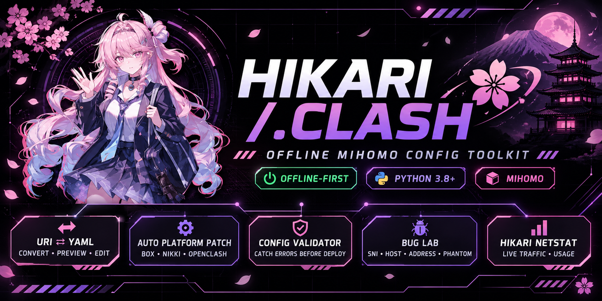
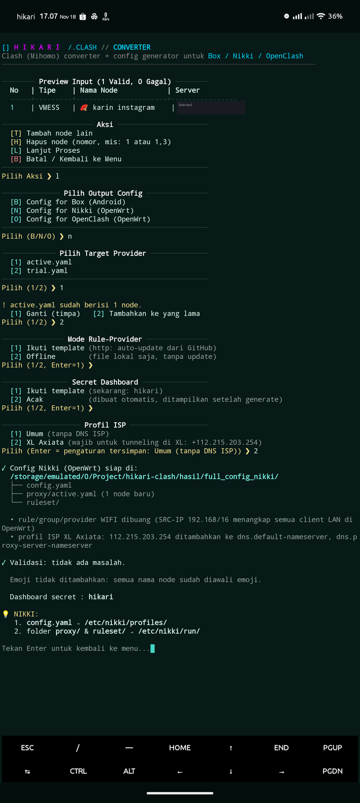
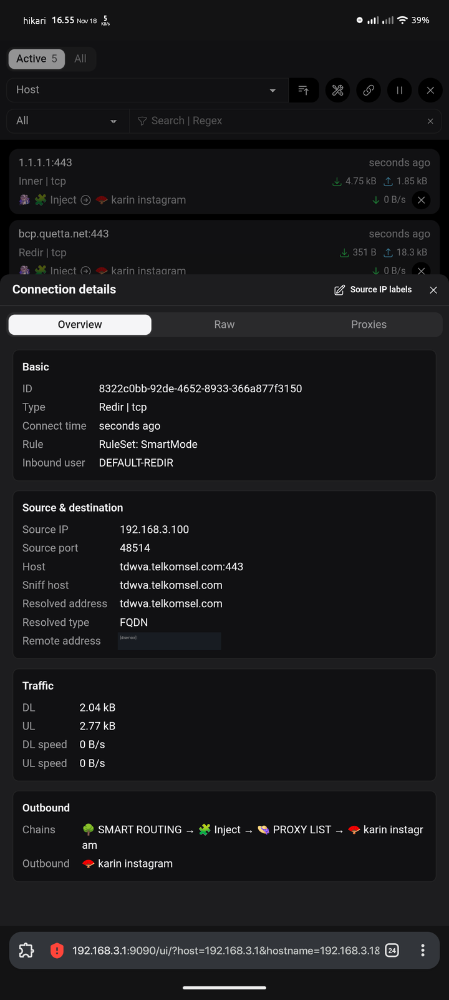
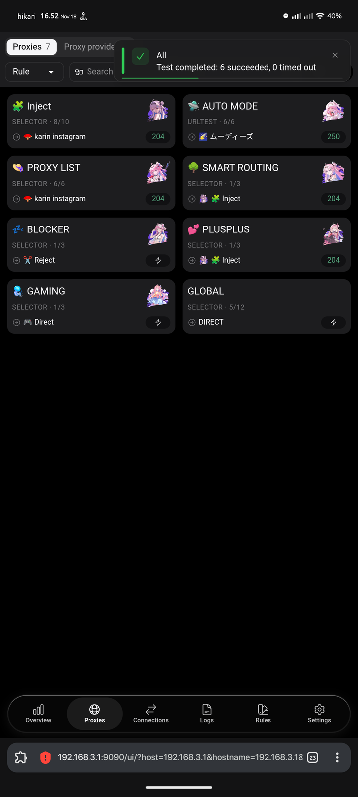
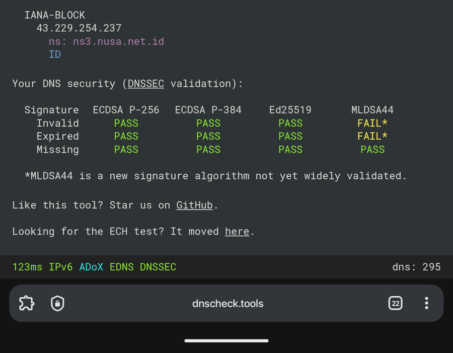

<div align="center">



**Toolkit CLI offline untuk convert & generate config Mihomo (Clash Meta)**
satu template → siap pakai di **Box for Root**, **Nikki**, dan **OpenClash**

<sub>Sebelumnya bernama *Hikari Subclash* / Hikari-SC.</sub>


</div>

---

## 📖 Daftar Isi

- [Kenapa Hikari?](#-kenapa-hikari)
- [Fitur](#-fitur)
- [Tampilan](#-tampilan)
- [Cara Kerja](#-cara-kerja)
- [Instalasi](#-instalasi)
- [Struktur Folder](#-struktur-folder)
- [Cara Pakai](#-cara-pakai)
- [Hikari NetStat](#-hikari-netstat)
- [Dokumentasi](#-dokumentasi) — usage, platform, template, tips, troubleshooting, FAQ, dll.
- [Roadmap](#-roadmap)
- [Disclaimer](#%EF%B8%8F-disclaimer)

---

## 💡 Kenapa Hikari?

Ngatur config Mihomo di tiga platform itu ribet: port beda, path beda, fitur Android (tun, per-app) bentrok dengan OpenWrt, dan hampir semua tool convert butuh internet. Hikari /.CLASH menyelesaikannya dengan:

- **Satu template netral**, bagian yang beda per platform disuntik otomatis.
- **Offline**: tempel link, jadi config. Tanpa subscription converter online.
- **Validator bawaan**: salah referensi group/rule/provider ketahuan *sebelum* config dipasang.

---

## ✨ Fitur

| | |
|---|---|
| 🔄 **Dua arah** | `vless://` `vmess://` `trojan://` ⇄ YAML Clash. Support WS, gRPC, HTTPUpgrade, H2, TLS, **Reality + flow/fingerprint**, ALPN, `allowInsecure`, IPv6 |
| 🎯 **Preview & edit** | Tabel preview, hapus/tambah node, baris gagal ditampilkan **lengkap dengan alasannya** |
| 🧬 **Anti duplikat** | Nama node kembar otomatis jadi `Nama (2)`, `Nama (3)` |
| 🌠 **Emoji per metode** | Emoji node mengikuti metodenya, bukan acak: `Singapore` → `🌠 Singapore` (asli), `🌌` (CloudFront), `🎬` bug-sni, `💭` bug-addr, … Bisa diedit di menu |
| 🛠️ **Auto-patch platform** | Port, DNS listen, `tun`, path provider, controller, rule WIFI disesuaikan per platform |
| ✅ **Validator** | Cek group/rule/provider, file provider, port bentrok, controller tanpa secret, DNS rawan, dll |
| 🔌 **Mode Offline** | Ubah semua rule-provider `http` → `file` (tanpa update GitHub) |
| 🧪 **Uji Bug / Custom** | Di Preview Convert (`[U]`) & Regenerate: uji **banyak SNI / Host / Address sekaligus**, atau **mode Lazy** (isi bug saja, semua metode address/port/host/SNI dicoba otomatis; bug berpath seperti `www.line.me/en` juga dicoba ganti path) dan **Phantom** untuk PhantomNG (mode TCP/TLS, Mihomo, V2Ray/Xray); yang lolos jadi node varian + `custom-*.yaml` & link URI — lihat [bugtest](docs/bugtest.md) |
| ♻️ **Regenerate** | Ubah template/DNS/profil ISP lalu bangun ulang config dari node yang sudah tersimpan — **tanpa paste URI lagi** (`1 → 3`) |
| ➕ **Replace / Append** | Timpa atau tambah node ke provider yang sudah ada |
| 🌐 **Menu DNS** | Preset (Cloudflare+Google, Quad9, NextDNS, AdGuard, [BebasDNS](https://github.com/bebasid/bebasdns)) dengan pilihan **DoH / DoT / DoQ**, atau **custom manual** (IP, DoH, DoH3, DoT, DoQ, UDP/TCP, `system`, `dhcp://`, akhiran `#proxy`) per field — divalidasi, ada preview diff, format & komentar template dijaga |
| 📦 **Box Utilities** | Android berroot + Box for Root: start / stop / restart, pasang hasil generate ke `/data/adb/box/clash/` (dengan persetujuan), ganti config aktif lewat `settings.ini`, lihat config, dashboard, log, update — lihat [docs/box.md](docs/box.md) |
| 🧪 **Miscellaneous** | Converter rule-provider `.mrs` ⇄ `.yaml`/`.txt`, tester config (+ `mihomo -t`), tester node (offline / via core), tester route, **sniffer only** (config pengintai koneksi + inspector) — lihat [menu 5](docs/misc-tools.md) |
| 🪪 **Info pengguna** | Di bawah banner: IP (lokal + publik), lokasi, jaringan **WiFi/Data**, **status core** (`Box Aktif` / `Nikki Aktif`), usage, versi core, ping. Ada sensor IP untuk screenshot — lihat [usage](docs/usage.md#info-di-bawah-banner) |
| 📊 **NetStat** | Collector statistik trafik **standalone**: harian/mingguan/bulanan, WiFi vs Data, top app, kuota paket — lihat [NetStat](#-hikari-netstat) |
| 🛡️ **Aman** | Auto-backup `.bak`, input divalidasi, `PermissionError` ditangani, pilihan secret dashboard (default `hikari` / acak) |

---

## 📸 Tampilan

<details>
<summary><b>Klik untuk membuka tangkapan layar</b></summary>

<br>

Tangkapan layar dari perangkat penulis (Termux + Nikki di OpenWrt, jaringan XL Axiata). IP server node disensor.

<table>
<tr>
<td align="center" width="50%"><br><sub><b>Converter di Termux</b> — preview node, pilih platform/provider, profil ISP XL, hasil validasi</sub></td>
<td align="center" width="50%"><br><sub><b>Rantai routing</b> — <code>SMART ROUTING → Inject → PROXY LIST → node</code> terlihat di dashboard Mihomo</sub></td>
</tr>
<tr>
<td align="center"><br><sub><b>Group dari template</b> — Inject, AUTO MODE, PROXY LIST, SMART ROUTING, BLOCKER, PLUSPLUS, GAMING</sub></td>
<td align="center"><br><sub><b>Ad Blocker Test</b> — 125 dari 130 diblokir (96%) dengan ruleset Blocker aktif</sub></td>
</tr>
</table>

<div align="center">
<br>
<sub><b>dnscheck.tools</b> setelah DNS memakai DoH berbasis IP (v0.7+): validasi DNSSEC lulus untuk ECDSA P-256/P-384 dan Ed25519; MLDSA44 bertanda * karena algoritmanya belum luas divalidasi (menurut halaman tesnya sendiri)</sub>
</div>

> Ini hasil di satu perangkat dan satu jaringan, bukan jaminan untuk setiap setup.

</details>

---

## 🧠 Cara Kerja


Pipeline: `template → parse YAML → patch per platform → validasi → tulis <operator>.yaml` (mis. `xl.yaml`, `byu.yaml`).

---

## 📦 Instalasi

**Termux (Android):**

```bash
pkg update && pkg install python git -y
termux-setup-storage
git clone https://github.com/nexterade/hikari-clash.git /storage/emulated/0/Project/hikari-clash
cd /storage/emulated/0/Project/hikari-clash
pip install -r requirements.txt
python3 hikari_converter.py
```

Shortcut, setelah itu cukup ketik `hikari-clash`:

```bash
printf '#!/bin/sh\ncd /storage/emulated/0/Project/hikari-clash && exec python3 hikari_converter.py "$@"\n' > "$PREFIX/bin/hikari-clash"
chmod +x "$PREFIX/bin/hikari-clash"
```

**Linux / OpenWrt / PC:**

```bash
git clone https://github.com/nexterade/hikari-clash.git
cd hikari-clash
pip install -r requirements.txt
python3 hikari_converter.py
```

> Di Termux jangan clone ke `~` (kena `PermissionError`).

Opsional, konversi `.mrs` (menu 5 → 1) butuh zstd. Python 3.14+ sudah bawaan; selain itu: `pkg install zstd` (Termux), `pip install zstandard`, atau `opkg install libzstd zstd` (OpenWrt). Cek di menu `5 → 5`.

---

## 📂 Struktur Folder

```text
hikari-clash/
├── hikari_converter.py          # Script utama (menu & generator)
├── sub2yaml.py                  # Subscription ➜ YAML Clash (free node)
├── bugtest.py                   # Uji Bug: kandidat SNI/Host/Address/Phantom atau mode Lazy ➜ tes TCP / Mihomo / V2Ray ➜ varian lolos
├── VERSION  CHANGELOG.md        # Versi aplikasi (SemVer) & riwayat perubahan
├── CLAUDE.md                    # Aturan kerja Claude/kontributor (version bump semantik wajib)
├── mrs_codec.py  nodetest.py  routetest.py  sniffer.py  httpcatch.py  banner.py  sysinfo.py   # tools menu 5 & pendukung
├── template/                    # Template master config_v*.yaml (+ sniffer_only.yaml)
├── ruleset/                     # Ruleset (WAJIB): *.yaml & *.mrs
├── netstat/                     # Hikari NetStat: collector statistik trafik (standalone)
├── docs/                        # Dokumentasi lengkap + img/ (screenshot)
├── tests/                       # Tes otomatis: python3 -m unittest discover -s tests
└── hasil/                       # (otomatis) hasil generate
```

Pohon lengkap beserta penjelasan tiap file ada di [docs/structure.md](docs/structure.md).

---

## 🚀 Cara Pakai

```bash
cd /storage/emulated/0/Project/hikari-clash
python3 hikari_converter.py
```

```text
[1] Convert                 ← link ⇄ Clash YAML, regenerate dari node tersimpan, impor free node (sub2yaml)
[2] Edit Configuration      ← port & secret, ganti template, DNS, emoji node
[3] Check Status            ← template, provider, config yang sudah jadi
[4] Validasi / Audit Config ← cek template untuk ketiga platform
[5] Miscellaneous           ← converter .mrs, tester config / node / route, sniffer only
[6] Box Utilities           ← (root) start/stop/restart Box, pasang & ganti config, dashboard, log
────────────────────────────
[Q] Exit
```

Alur singkat: **paste link** → **preview** → pilih **platform** (`B` Box · `N` Nikki · `O` OpenClash), provider, dan **operator** (xl, axis, smartfren, telkomsel, byu, indosat, three, atau nama sendiri) → salin hasil dari `hasil/` ke perangkat. Tiap operator punya file sendiri (`xl.yaml`) dan folder provider sendiri (`proxy/xl/`), jadi hasil beberapa operator tidak saling menimpa.

| Platform | Folder hasil | Salin ke |
|---|---|---|
| 📱 Box | `hasil/full_config_box/` (semua isi) | `/data/adb/box/clash/` |
| 🐧 Nikki | `hasil/full_config_nikki/` | `<operator>.yaml` → `/etc/nikki/profiles/`; `proxy/` + `ruleset/` → `/etc/nikki/run/` |
| 🐧 OpenClash | `hasil/full_config_openclash/` | `<operator>.yaml` → `/etc/openclash/config/`; `proxy_provider/` + `rule_provider/` → `/etc/openclash/` |

Langkah rinci tiap menu: [docs/usage.md](docs/usage.md). Detail pemasangan & beda output per platform: [docs/platforms.md](docs/platforms.md).

---

## 📊 Hikari NetStat

Collector statistik trafik Mihomo yang **berdiri sendiri** (folder [`netstat/`](netstat/)): pemakaian **harian / mingguan / bulanan**, dipisah **WiFi vs Data seluler**, plus top aplikasi, group, dan jalur keluar (Direct / Proxy / Reject), kecepatan live, dan pantauan kuota paket. Riwayat disimpan permanen di `stats.json`; laporannya halaman web ringan di `http://127.0.0.1:9099/`.

- **Tidak butuh** config Hikari, ruleset, atau folder proxy. Cukup external-controller Mihomo yang bisa dijangkau, jadi bisa dipakai juga dengan config buatan sendiri.
- Satu binary Go statis (arm64, tanpa dependensi), jalan otomatis tiap boot lewat `service.d`.
- Hanya *membaca* `/connections`; tidak mengubah config atau perilaku core.

```bash
cd netstat
sh install.sh                                    # Android root (Box for Root)
vi /data/adb/hikari-stats/stats.conf             # SECRET = secret controller (default template Hikari: hikari)
sh /data/adb/hikari-stats/stats-ctl.sh restart
```

Lalu buka `http://127.0.0.1:9099/` di browser HP. Konfigurasi, cara kerja klasifikasi WiFi/Data, API, backup, dan keamanan: [docs/netstat.md](docs/netstat.md).

---

## 📚 Dokumentasi

| Dokumen | Isi |
|---|---|
| [docs/usage.md](docs/usage.md) | Alur Convert, Regenerate, Clash ➜ URI, Edit Configuration (port, template, DNS, emoji) |
| [docs/bugtest.md](docs/bugtest.md) | Uji Bug / Custom: tes banyak SNI · Host · Address sekaligus, mode Lazy (otomatis semua metode), Phantom, mode TCP / Mihomo / V2Ray, keluaran |
| [CHANGELOG.md](CHANGELOG.md) | Riwayat perubahan per versi aplikasi (SemVer) |
| [docs/sub2yaml.md](docs/sub2yaml.md) | Free node: impor ke ☘️ FREE NODE dan `sub2yaml.py` |
| [docs/misc-tools.md](docs/misc-tools.md) | Menu 5: converter `.mrs`, tester config / node / route |
| [docs/sniffer.md](docs/sniffer.md) | Sniffer Only: config pengintai koneksi + inspector + penangkap path HTTP (bug catcher) |
| [docs/box.md](docs/box.md) | Box Utilities (menu 6, root): start/stop/restart, pasang & ganti config, dashboard, log |
| [docs/platforms.md](docs/platforms.md) | Memasang hasil ke Box / Nikki / OpenClash, beda output per platform |
| [docs/template.md](docs/template.md) | Isi template, urutan rule, group node, ruleset |
| [docs/template-changelog.md](docs/template-changelog.md) | Beda antar versi template (v0.3 → v1.3) |
| [docs/netstat.md](docs/netstat.md) | Hikari NetStat: pasang, konfigurasi, API, keamanan |
| [docs/tips.md](docs/tips.md) | Tips & trik, termasuk DNS, secret, debug |
| [docs/troubleshooting.md](docs/troubleshooting.md) | Gejala → penyebab → solusi |
| [docs/faq.md](docs/faq.md) | Pertanyaan yang sering muncul |
| [docs/structure.md](docs/structure.md) | Pohon folder lengkap |
| [AUDIT.md](AUDIT.md) | Perbandingan template, temuan audit, saran |

---

## 🗺️ Roadmap

- [x] Tester config + `mihomo -t` lokal (menu 5 → 2) · [ ] Uji otomatis dengan core asli di CI
- [ ] Overlay platform sebagai file (`platforms/*.yaml`), bukan di dalam kode
- [ ] Protokol: `ss://`, `hy2://`, TUIC, `xhttp`
- [ ] Mode non-interaktif (`--platform nikki --input nodes.txt --offline`)
- [ ] Impor subscription URL + filter/rename node + group per negara
- [ ] Mirror CDN untuk rule-provider
- [ ] Rule GAMING khusus UDP & dipecah per game

Detail dan alasannya ada di bagian *Saran Pengembangan* pada [`AUDIT.md`](AUDIT.md).

---

## ⚠️ Disclaimer

Proyek ini dibuat untuk mempermudah pengelolaan konfigurasi pribadi. Pastikan penggunaanmu mematuhi hukum dan peraturan yang berlaku di wilayahmu terkait jaringan proxy/VPN. Penulis tidak bertanggung jawab atas penyalahgunaan.

*Don't be stupid, use it wisely.* 🫰

<div align="center">

Hikari /.CLASH · Made with 🌸 for Box · Nikki · OpenClash

</div>
